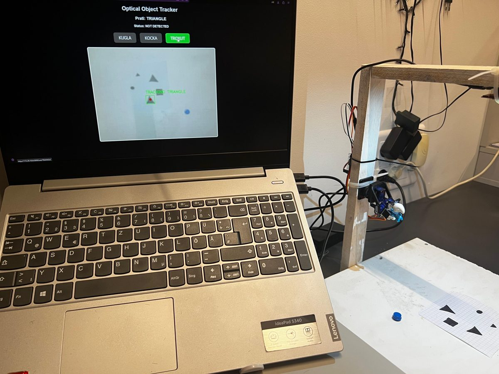
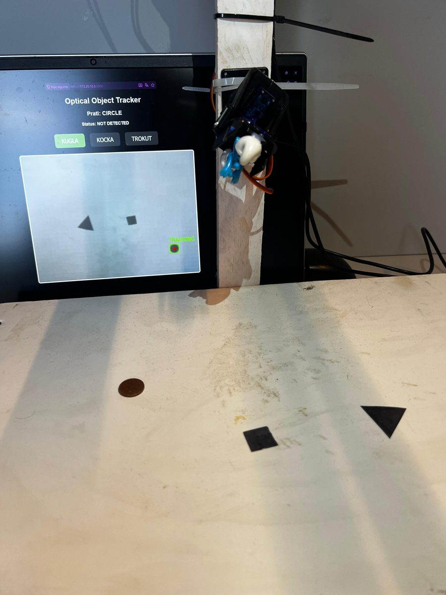
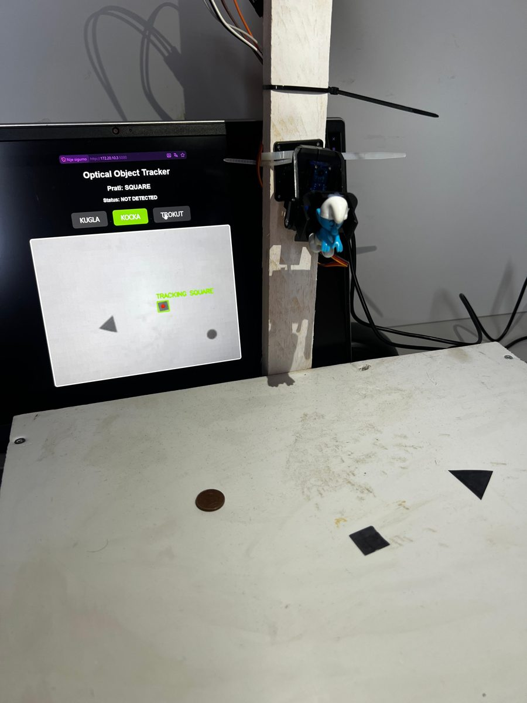
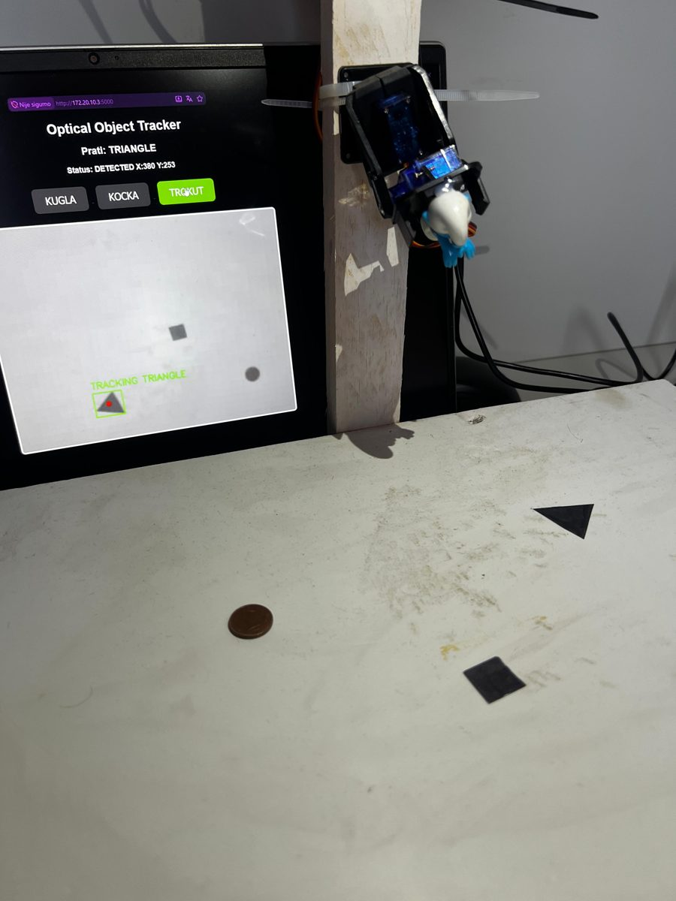
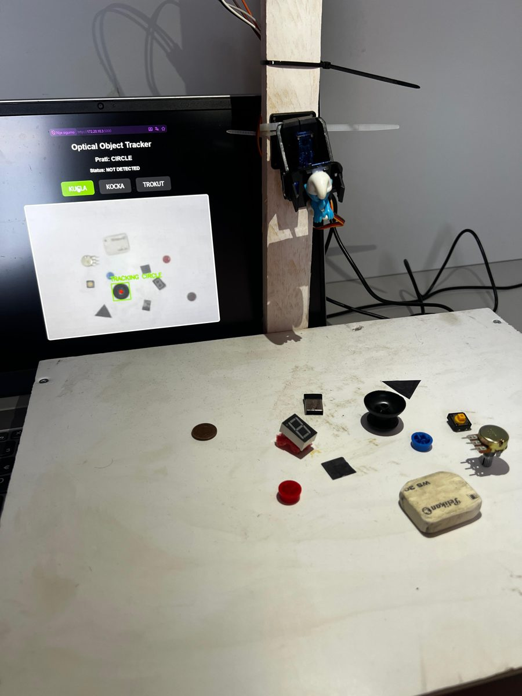
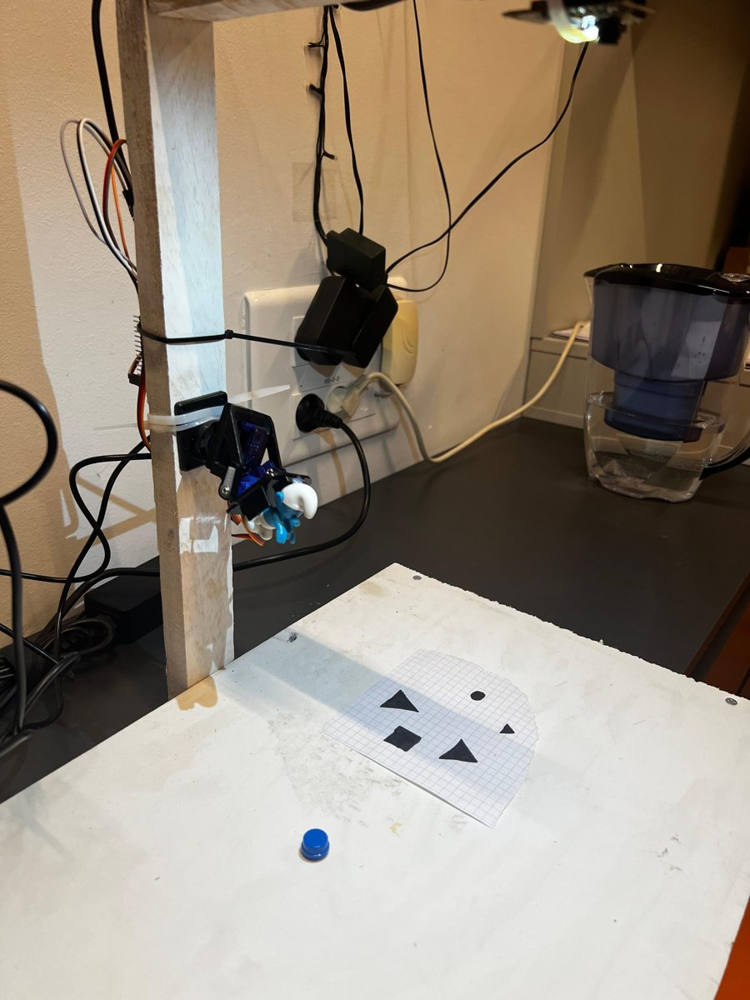

# Optical Object Tracker

Sustav za optičko praćenje objekata zadanog oblika (krug, kvadrat, trokut). Kamera (ESP32-CAM) šalje video računalu, Python program (OpenCV) pronalazi odabrani oblik u slici, a koordinate se preko serijske veze šalju na ESP32 koji pomiče **dva servo motora** (pan/tilt) tako da kamera prati objekt.

Projekt iz kolegija *Ugradbeni računalni sustavi*, FERIT Osijek, 2025/2026.
Autori: Daniel Anđelić, Anto Kožarević · Mentor: prof. dr. sc. Tomislav Keser



## Kako radi

```
ESP32-CAM ──(MJPEG stream, WiFi)──► Računalo (Python + OpenCV)
                                         │  detekcija oblika, središte objekta (x, y)
                                         ▼
                              serijska veza "x,y\n" (115200)
                                         ▼
                              ESP32 ──► servo X (GPIO 18), servo Y (GPIO 19)
```

1. Slika se smanji na 640×480, pretvori u sive tonove, zamuti i obradi Cannyjevim detektorom rubova.
2. Iz rubova se izdvoje konture. Oblik se prepoznaje po površini, broju vrhova aproksimirane konture i kružnosti.
3. Središte najveće konture odabranog oblika se zagladi (eksponencijalno) i pošalje na ESP32.
4. ESP32 preslika koordinate u kutove servo motora (30°–150°) i pomakne kameru prema objektu.
5. Oblik koji se prati bira se u web sučelju (`http://localhost:5000`).

## Rezultati

Praćenje pojedinih oblika kroz web sučelje:

| Krug | Kvadrat | Trokut |
|:---:|:---:|:---:|
|  |  |  |

Detekcija u kadru s više različitih predmeta (kovanica, tipkala, gumica, potenciometar...) – prepoznaje se samo traženi oblik:

<p align="center"></p>

## Hardver

- ESP32-CAM (AI-Thinker) – video stream
- ESP32 DevKit – primanje koordinata i upravljanje servo motorima
- 2× servo motor u pan/tilt nosaču (GPIO 18 – horizontalna os, GPIO 19 – vertikalna os)
- Drvena konstrukcija za držanje kamere, računalo za obradu slike



## Struktura repozitorija

| Mapa | Sadržaj |
|------|---------|
| `python/` | Obrada slike (OpenCV), web sučelje (Flask) i slanje pozicije na ESP32 |
| `firmware/servo_receiver/` | Arduino sketch za ESP32 – prima `x,y` i pomiče servo motore |
| `CameraWebServer/` | Dijelovi Espressif CameraWebServer primjera (AI-Thinker ESP32-CAM) |
| `docs/` | Tehnička dokumentacija (PDF, DOCX), prezentacija i slike |

Skripte u `python/`:

- `stream_viewer.py` – provjera da se video stream s kamere otvara
- `shape_detector.py` – detekcija oblika bez servo motora (samo prikaz)
- `serial_test.py` – test serijske veze i servo motora
- `tracker_to_servo.py` – praćenje s prikazom u OpenCV prozoru
- `web_tracker.py` – praćenje s web sučeljem za odabir oblika

## Pokretanje

```bash
pip install -r requirements.txt
python python/web_tracker.py
```

Prije pokretanja u skriptama postavite `stream_url` (IP adresa ESP32-CAM) i serijski port (`COM6`). Zatim otvorite `http://localhost:5000` i odaberite oblik koji se prati.

## Dokumentacija

Cjelovit opis projekta: [`docs/Optical_Object_Tracker.pdf`](docs/Optical_Object_Tracker.pdf)
